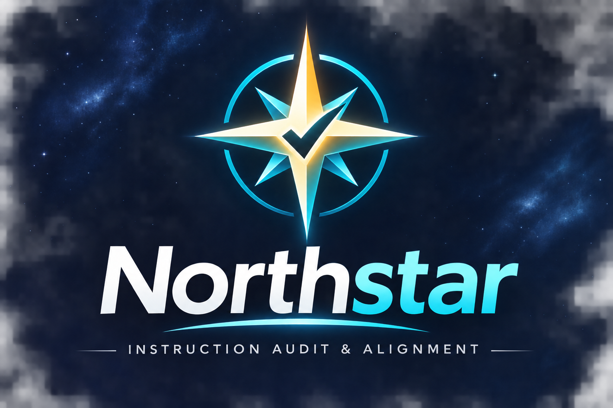

<p align="center">
  
</p>

# Hermes Northstar Plugin

Northstar is a native Hermes Agent plugin that audits your instruction sources for coherence. It scans SOUL.md, SKILL.md, project instruction files, and configuration for contradictory directives, duplicate instructions, and stale file references — then reports findings with severity levels and suggested fixes.

Northstar is **read-only**: it detects and reports problems in your instructions. It never edits, rewrites, or automatically repairs any instruction file.

## Quick Demonstration

The repository ships a demo fixture with two synthetic instruction files that contain deliberate conflicts. Run it from the repository root:

```bash
python -m northstar.demo
```

Expected output:

- **2 sources** inspected (`ExampleCore.md`, `ExampleBehavior.md`)
- **5 findings**, including **1 error** (a cross-file contradiction where one file allows what the other denies)

The fixture lives in `fixtures/conflicting-demo/`:

- `ExampleCore.md` — core directives
- `ExampleBehavior.md` — behavior rules (contains cross-file contradictions with ExampleCore.md)
- `README.md` — explanatory text (excluded from the audit scan)

## Features and Detection Categories

| Category | What it detects |
|----------|-----------------|
| `duplicate` | Near-duplicate directive lines appearing in multiple instruction files (normalized text comparison; YAML frontmatter metadata is excluded) |
| `contradiction` | Conflicting directives within a single file and across files, using predefined allow/deny pattern pairs (e.g., "require approval" vs "without asking") |
| `stale_reference` | File path references in instruction files that do not resolve to an existing file (context-aware: skips markdown links, code blocks, inline code, doc cross-references, and URLs) |

Additional behaviors:

- **Scope-aware contradiction classification** — when both sides of a contradiction carry different scope qualifiers (e.g., "production files" vs "test files"), the finding is downgraded to a warning with low confidence, flagged for human review rather than reported as a definite error.
- **Severity levels** — `error`, `warning`, `info`.
- **Confidence levels** — `high`, `medium`, `low` (heuristic, not calibrated against ground truth).
- **Report formats** — human-readable text or machine-readable JSON.
- **Archived directory exclusion** — directories named `.archive`, `.backup`, `deprecated`, etc. are skipped by default.

## Installation and Enablement

Northstar is a native Hermes plugin. Install it with the Hermes CLI:

```bash
hermes plugin install /path/to/hermes-northstar
```

Or copy the plugin directory into your Hermes plugins path:

```bash
cp -r hermes-northstar ~/.hermes/plugins/northstar
```

After installation, restart Hermes (or start a new session) so the plugin registers its tools and hook. Verify it is active:

```bash
hermes plugin list
```

## Tool Usage

### `northstar_audit`

Run a coherence audit on instruction sources.

| Parameter | Type | Values | Default |
|-----------|------|--------|---------|
| `scope` | string | `full`, `home`, `project`, `skills` | `full` |
| `output_format` | string | `text`, `json` | `text` |

- `scope: "full"` — scans Hermes home, project root, and skills
- `scope: "home"` — scans Hermes home only
- `scope: "project"` — scans project root only
- `scope: "skills"` — scans the skills directory only

Example:

```
northstar_audit scope=full output_format=json
```

### `northstar_status`

Show current plugin status.

| Parameter | Type | Default |
|-----------|------|---------|
| `include_last_audit` | boolean | `false` |

Returns plugin name, version, enforcement mode, and protected paths. With `include_last_audit: true`, it also returns the results of the most recent `northstar_audit` call (or a note if no audit has been run yet).

## Hook Behavior

Northstar registers one hook: `pre_llm_call`.

On the **first turn of a session**, the hook checks whether a cached audit result exists (from a previous `northstar_audit` call in the same process). It does **not** automatically run an audit. If relevant cached findings exist (errors or warnings), it returns a compact advisory context block (capped at 2000 characters) summarizing the top findings and pointing to `northstar_audit` for full details. If no cached audit exists, or the audit was clean, the hook returns nothing and the turn proceeds normally.

The hook matches the standard Hermes `pre_llm_call` contract: `(session_id, user_message, conversation_history, is_first_turn, model, platform, **kwargs)`.

## Architecture

```
hermes-northstar/
├── plugin.yaml          # Plugin manifest (name, version, tools, hooks, config schema)
├── northstar/
│   ├── __init__.py      # Plugin registration: wires tools and the pre_llm_call hook
│   ├── schemas.py       # Tool parameter schemas (what the LLM sees)
│   ├── tools.py         # Tool handlers: northstar_audit, northstar_status
│   ├── discovery.py     # Instruction source discovery and classification
│   ├── audit.py         # Deterministic audit checks and report generation
│   └── demo.py          # Runnable demo against the conflicting fixture
├── fixtures/
│   └── conflicting-demo/  # Synthetic instruction files with known conflicts
└── tests/
    └── test_northstar.py  # Automated test suite
```

Data flow:

1. **Discovery** (`discovery.py`) finds instruction sources in Hermes home, project root, and skills, classifies each file (`instruction`, `config`, `skill`), and excludes archived directories.
2. **Audit** (`audit.py`) runs the detection checks over the discovered sources and produces an `AuditReport` with findings, severity, confidence, and per-category counts.
3. **Tools** (`tools.py`) expose the audit to the LLM via `northstar_audit` and `northstar_status`, and cache the last report in process memory.
4. **Hook** (`__init__.py`) reads the cached report on the first turn and optionally injects compact advisory context.

## Testing and Validation

- **96 automated tests** covering discovery, audit logic, tools, registration, hooks, scope-aware contradictions, and input validation.
- Official **Plugin Doctor** and plugin validation passed.
- Baseline commit: `dec9074`.

Run the test suite:

```bash
python -m pytest tests/ -v
```

## Known Limitations

The audit uses deterministic pattern matching, not semantic analysis:

1. **Contradiction patterns are finite** — only predefined allow/deny phrase pairs are checked (e.g., "always confirm" vs "skip confirm"). Novel contradictions may be missed.
2. **Scope detection is pattern-based** — recognizes common scope qualifiers (production/test/dev/config/new file/routine task/CI-CD) but may miss custom or implicit scopes. Unrecognized scopes are reported as possible conflicts requiring human review.
3. **Duplicate detection is text-normalization based** — semantically identical but differently worded directives may not be caught.
4. **Stale reference check is filesystem-only** — cannot detect references to external URLs, database entries, or dynamically generated paths.
5. **Confidence levels are heuristic** — not calibrated against ground truth.
6. **Tool availability and model reference checks are skipped** — they require Hermes runtime or provider API access, which the audit does not have. They are listed in the report under "checks skipped."
7. **No enforcement** — Northstar is read-only. The `enforce_mode` and `protected_paths` config keys exist in the schema but enforcement behavior is not yet implemented.

## License and Project Status

- **License:** MIT (see [LICENSE](LICENSE)).
- **Version:** 0.1.0
- **Status:** Functional, validated initial release.
- **Quality assurance:** 97 passing automated tests; Hermes Plugin Doctor and plugin validation passed, including security checks.
- **Integration:** 2 registered tools and 1 registered hook.
- **Operation:** Read-only instruction auditing. Reports potential contradictions, duplicate directives, and stale references with supporting evidence.
- **Limitations:** Detection is heuristic, and findings may require human review.
- **Repository:** https://github.com/mrcoxis-2002/hermes-northstar
